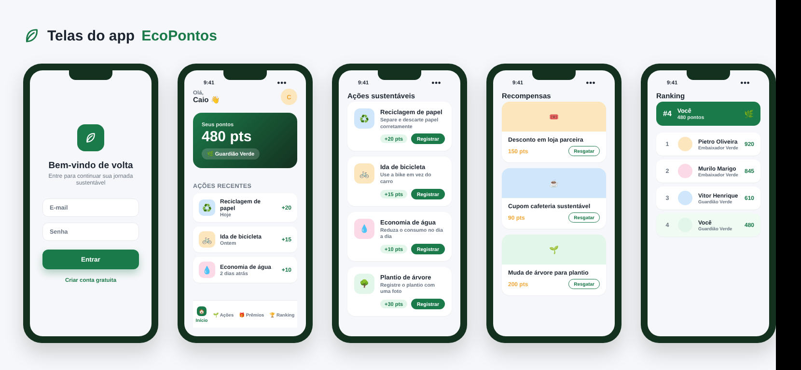
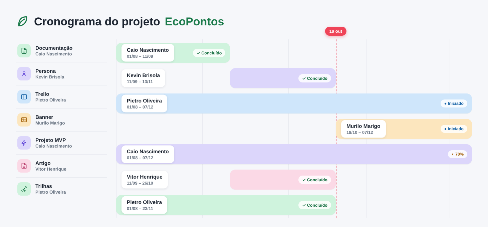

# 🌿 EcoPontos

Plataforma web gamificada que transforma **ações sustentáveis em pontos** e os pontos em **recompensas** (vouchers em lojas parceiras).
Projeto da disciplina UPX2 — Facens. Equipe **NextCity**: Caio Barreto Oliveira do Nascimento, Murilo Marigo, Kevin Brisola, Pietro Oliveira e Vitor Henrique. Orientadora: Profa. Brenda Oliveira.



## Funcionalidades

- Cadastro e login com senha criptografada (BCrypt) e autenticação por token JWT
- Catálogo de ações sustentáveis (reciclagem, mobilidade, água, energia, plantio)
- **Limite diário:** cada ação pode ser registrada uma vez por dia por usuário
- **Comprovação por foto:** a ação fica "em análise" e os pontos só entram quando um administrador aprova
- Recompensas com controle de estoque e **vouchers com código único** (ex.: `ECO-7F3K-92QX`)
- Aba **Meus vouchers** e tela de **validação** para lojas parceiras (o voucher é marcado como usado, nunca apagado)
- **Ranking por pontos acumulados** e níveis (Iniciante, Explorador Verde, Guardião Verde, Embaixador Verde)
- Histórico de ações, resgates e extrato de pontos

## Tecnologias

Java 17 · Spring Boot 3 (Web, Data JPA, Security, Validation) · MySQL 8 · JWT (jjwt) · HTML, CSS e JavaScript puro

## Estrutura

```
src/main/java/com/example/ecopontosapi/
  config/  controller/  dto/  model/  repository/  security/  service/
src/main/resources/
  static/            telas (index.html = login, app.html = app)
  application.properties (sem senha; usa variáveis de ambiente)
database/            scripts SQL (local e nuvem)
docs/imagens/        telas do app e cronograma
```

## Como rodar (no seu computador)

1. Instale Java 17, Maven e MySQL 8.
2. No MySQL Workbench, rode `database/01_schema.sql`, `database/02_dados_iniciais.sql` e `database/04_mais_recompensas.sql`.
3. Na raiz do projeto, crie o arquivo `application-local.properties` (ele não vai para o GitHub) com: `spring.datasource.password=SUA_SENHA_DO_MYSQL`
4. Rode a classe `EcopontosApiApplication` (IntelliJ) ou `mvn spring-boot:run`.
5. Acesse **http://localhost:8080**, crie uma conta e use o app.
6. Para validar vouchers e aprovar fotos, torne a sua conta administradora:
   ```sql
   UPDATE users SET role = 'ADMIN' WHERE email = 'seu-email@exemplo.com';
   ```

Para publicar na nuvem (Render + Aiven), veja o `DEPLOY.md`.

## Perfis

| Perfil | O que pode fazer |
|---|---|
| USER | registrar ações, resgatar recompensas, ver vouchers, ranking e histórico |
| PARTNER | validar vouchers na loja |
| ADMIN | validar vouchers e aprovar/rejeitar fotos de comprovação |

## Principais rotas da API

| Método | Rota | Descrição |
|---|---|---|
| POST | `/api/auth/register`, `/api/auth/login` | cadastro e login |
| GET | `/api/actions`, `/api/rewards` | listas públicas |
| POST | `/api/actions/{id}/register` | registra ação (com foto, quando exigida) |
| POST | `/api/rewards/{id}/redeem` | resgata recompensa e gera voucher |
| GET | `/api/vouchers` | meus vouchers |
| GET / POST | `/api/vouchers/{code}` e `/{code}/use` | consultar e usar voucher (PARTNER/ADMIN) |
| GET | `/api/ranking`, `/api/history`, `/api/users/me` | ranking, histórico e perfil |
| GET / POST | `/api/admin/proofs`, `.../approve`, `.../reject` | aprovação de fotos (ADMIN) |

## Segurança

- A senha do banco nunca fica no código: no computador vem do `application-local.properties` (no `.gitignore`) e na nuvem de variáveis de ambiente.
- A chave do JWT vem da variável `JWT_SECRET` na nuvem.
- As fotos enviadas ficam na pasta `uploads/`, que também não vai para o GitHub.

## Cronograma


